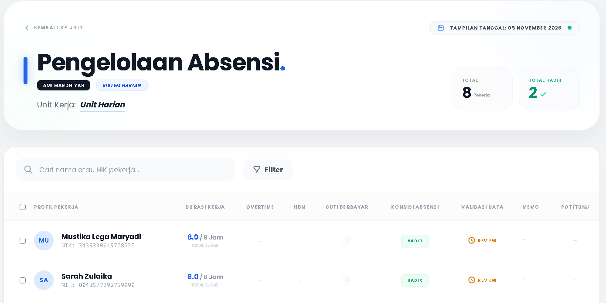
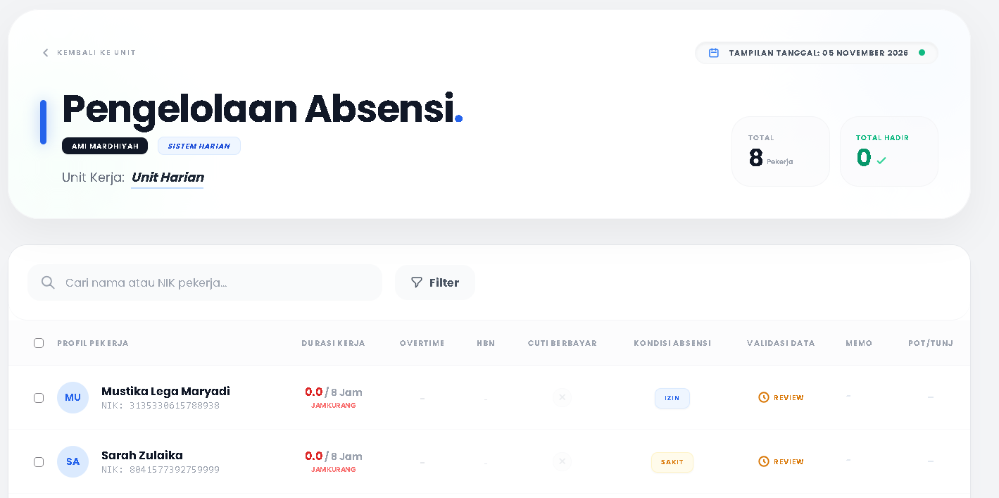
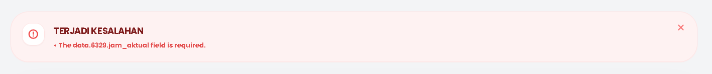

# Attendance Test Cases

> **Project:** MJA Integrated HR & Payroll System  
> **Module:** Daily Attendance  

## ATC-001 — Update an Existing Attendance Record

| Field | Details |
|---|---|
| Test scenario | Verify that changing an employee's attendance updates the existing record rather than creating a second record. |
| Test type | Functional / Data integrity |
| Priority | High |
| Preconditions | User is logged in with permission (Unit's PIC) to manage attendance. The employee is assigned to the selected unit. An attendance record already exists for that employee, date, and unit. |
| Test data | Employee: `Mustika Lega Maryadi / Sarah Zulaika`; Unit: `UNIT-HARIAN`; Date: `5-11-2026`; Existing status: `Hadir`; New status: `Izin` or `Sakit`. |

**Test steps**
1. Log in using an authorized account.
2. Open the Daily Attendance page (Absensi).
3. Select the date containing the existing attendance record and choose the unit.
4. Locate and select(tickbox) of the employee.
5. Choose `Status` at the bulk action bar below.
6. Change the attendance status from `Hadir` to `Izin/Sakit`.
6. Save the changes.
7. Reopen or refresh the attendance page (Absensi) and verify the record.
8. If database access is available, verify the number of records for the same employee, date, and unit.

**Expected result**
- The employee's existing attendance record is updated to `Izin/Sakit`.
- No additional attendance row is created for the same employee, date, and unit.
- The updated value remains visible after refreshing the page.

**Actual result:** To be recorded during execution.  
- The application updates the previous record.
- The attendance status changed from `Hadir` to `Izin/Sakit`
- No duplicate entry of attendance record saved in the database. 
**Status:** Pass

### Test Evidence

**Before updating attendance**

**After updating attendance**

---

## ATC-002 — Validate Required Attendance Data

| Field | Details |
|---|---|
| Test scenario | Verify that the application handles missing required attendance input. |
| Test type | Negative / Validation |
| Priority | High |
| Preconditions | User is logged in with permission(Unit's PIC) to manage attendance and can access the attendance input form. |
| Test data | Leave one required field or selection empty. Confirm which fields are mandatory in the actual form before execution. |

**Test steps**
1. Log in using an authorized account.
2. Open the Daily Attendance page (Absensi).
3. Select the date containing the existing attendance record and choose the unit.
4. Select any test employee.
5. Choose `Absen` at the bulk action bar below.
6. Enter valid values in the other required fields.
7. Leave one required field or selection empty.
8. Attempt to save the attendance.
9. Observe the validation response.
10. Check whether an incomplete attendance record was created. 

**Expected result**
- The application prevents form submission when a required field is missing.
- A clear, user-friendly validation message is displayed identifying the missing field using its UI label (e.g., "Jam Aktual wajib diisi" or "Kolom Jam Aktual tidak boleh kosong") rather than internal system attributes or raw array keys.
- The message matches the application's active language setting (Indonesian).
- No incomplete or unintended attendance record is saved in the database.

**Actual result:** The system prevented submission, but the validation toast displayed an unformatted internal technical error (The data.6329.jam_aktual field is required.) instead of a user-friendly, localized field name (e.g., "Jam Kerja wajib diisi").
**Status:** Fail

### Test Evidence

**Validation Error Message**

---
